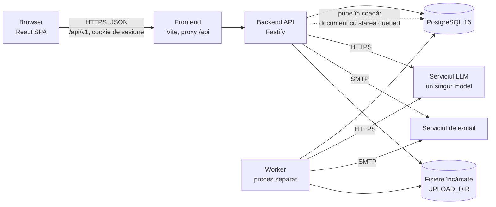
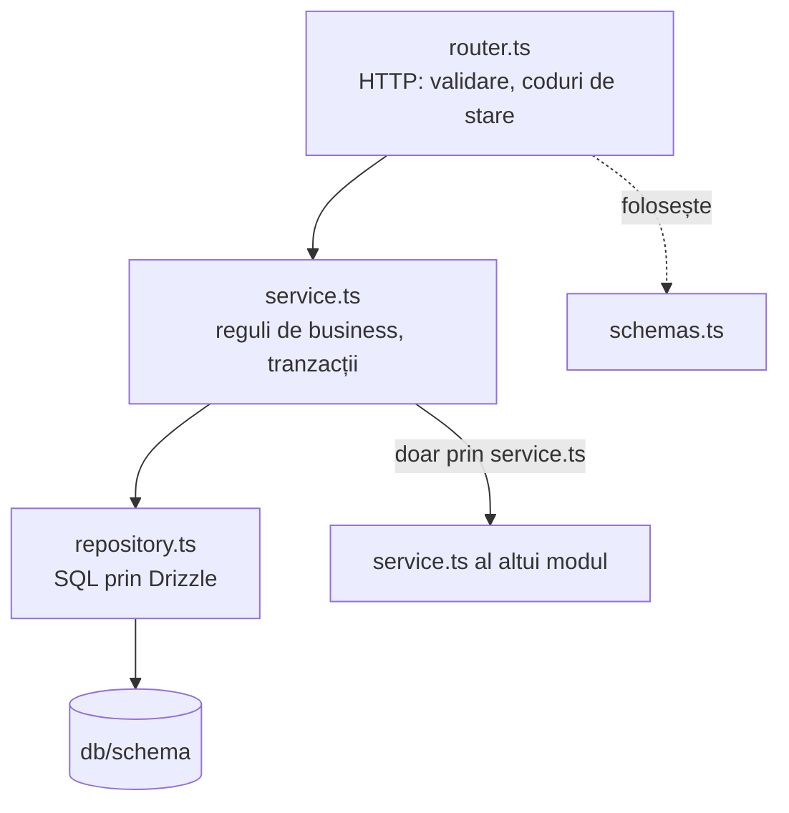
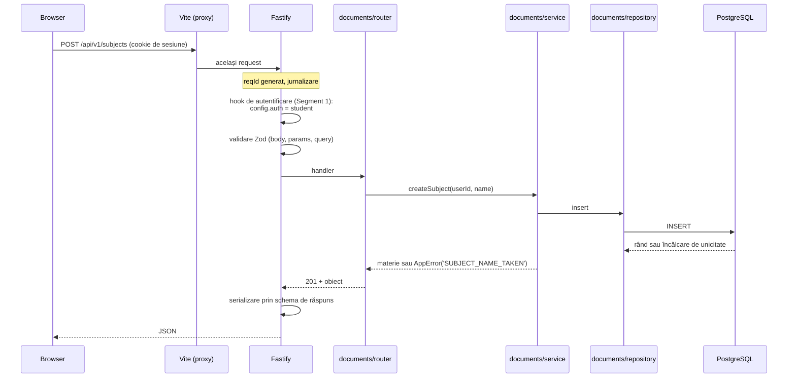

# Arhitectura

Aplicație web pentru recapitularea activă și adaptată a materialelor universitare. Documentul
descrie structura, straturile, drumul unei cereri și locul în care rulează procesele de fundal.
Deciziile și alternativele respinse sunt în `docs/ADR/`.

## 1. Imagine de ansamblu



Patru procese: baza de date, API-ul, workerul și frontendul. API-ul și workerul sunt același cod
(`backend/`), pornit cu două puncte de intrare: `src/server.ts` și `src/worker.ts`.

## 2. Structura repozitoriului

```
backend/
  src/
    server.ts            intrarea HTTP
    worker.ts            intrarea procesului de fundal
    app.ts               construiește aplicația Fastify (fără efecte secundare)
    core/                infrastructură comună, fără logică de business
      config.ts            variabile de mediu validate la pornire
      errors.ts            catalogul unic de erori (M01–M09)
      error-handler.ts     singurul loc unde o eroare devine răspuns HTTP
      http.ts              endpoint(), paginare, formatul erorii
      api-schemas.ts       forme API folosite de mai multe module
      domain.ts            valorile închise (stări, tipuri, roluri)
      logger.ts            jurnal JSON structurat + auditLog()
      openapi.ts           generarea OpenAPI
      health.ts            /health
      worker.ts            rularea periodică a sarcinilor de fundal
    db/
      schema/              cele 16 tabele (Drizzle)
      client.ts            singurul loc unde se creează conexiunea
      migrate.ts           aplicarea și anularea migrărilor
      seed.ts              valorile implicite din `settings`
    modules/             câte un modul pentru fiecare segment
      auth/  documents/  analysis/  llm/  content/  mastery/  reminders/  admin/
        router.ts            rutele și schemele lor
        schemas.ts           forme de cerere și răspuns (Zod)
        service.ts           logica; SINGURA suprafață publică a modulului
        repository.ts        interogările SQL ale modulului
    scripts/export-openapi.ts
  drizzle/               migrări (up generate, down scrise de mână)
  tests/
frontend/                schelet React + TypeScript; tipuri generate din openapi.json
infra/                   Dockerfile-uri și docker-compose.yml
docs/                    specificații, ADR, model de date, întrebări deschise, openapi.json
legacy/express/          prototipul inițial, doar ca referință pentru Segmentul 2
```

## 3. Straturile unui modul



| Strat           | Are voie                                                        | Nu are voie                                              |
| --------------- | --------------------------------------------------------------- | -------------------------------------------------------- |
| `router.ts`     | să declare rute cu `endpoint()`, să apeleze serviciul propriu   | SQL, reguli de business, verificări de rol               |
| `schemas.ts`    | forme Zod pentru cereri și răspunsuri                           | importuri din `db/`                                      |
| `service.ts`    | reguli, tranzacții, apeluri către `service.ts` al altor module  | să primească sau să întoarcă obiecte `request` / `reply` |
| `repository.ts` | interogări pe tabelele modulului                                | să apeleze alte module                                   |

Două reguli sunt verificate automat de ESLint (`backend/eslint.config.js`):

1. Un modul importă din alt modul **numai** `service.ts`. `router.ts`, `repository.ts` și
   `schemas.ts` ale altui modul sunt private.
2. `router.ts` și `schemas.ts` nu importă nimic din `db/`.

Formele folosite de mai multe module (de exemplu `Passage`, `Source`) stau în
`core/api-schemas.ts`, tocmai pentru că modulele nu își pot importa reciproc `schemas.ts`.

Schema bazei de date stă în afara modulelor (`db/schema/`), pentru că migrările au nevoie de
toate tabelele, iar cheile străine traversează modulele. Fiecare tabel are totuși un singur modul
care scrie în el (DATA_MODEL.md, secțiunea 2).

## 4. Fluxul unei cereri

Exemplu: `POST /api/v1/subjects` cu `{ "name": "Baze de date" }`.



Pași ficși, în ordine:

1. **Identificator de cerere** (`reqId`, UUID) atașat fiecărei linii de jurnal.
2. **Autentificare și rol**: fiecare rută își declară nivelul de acces prin `endpoint()`
   (`public`, `student`, `admin`, `any`), în `config.auth`. Segmentul 1 adaugă un singur hook
   global `preHandler` care citește `request.routeOptions.config.auth`, verifică cookie-ul și
   pune `request.user`. Routerele nu verifică roluri. Aplicația refuză să pornească dacă o rută
   din `/api/v1` nu își declară accesul (`requireDeclaredAccess`).
3. **Validare**: schema Zod a rutei. Eșecul devine `400 VALIDATION_ERROR` cu lista câmpurilor.
4. **Handler → serviciu → repository**.
5. **Erori**: codul aruncă `new AppError('COD')`; `core/error-handler.ts` produce răspunsul.
6. **Serializare**: răspunsul trece prin schema declarată; un câmp nedeclarat nu ajunge la
   client, iar un răspuns care nu respectă schema devine `500` și este jurnalizat.

## 5. Contractul API

- Prefix `/api/v1`. `/health` există și la rădăcină (containere, CI) și sub prefix (prin proxy).
- `snake_case`, identificatori întregi, timp ISO 8601 UTC, date `YYYY-MM-DD`.
- Eroare: `{ "error": { "code": "...", "message": "...", "details": ... } }`. `code` este stabil
  și este ceea ce verifică frontendul; `message` este textul în română; `details` este opțional.
- Listă: `?page=1&page_size=20` → `{ "items": [], "total": 0, "page": 1, "page_size": 20 }`.
- Fiecare operație începe cu `[UC-xx]` în `summary`, ca să poată fi urmărită până la cazul de
  utilizare. Un test verifică acoperirea UC-01..UC-17.
- `docs/openapi.json` și `frontend/src/api/schema.d.ts` sunt **generate** (`make openapi`).
  CI pică dacă nu sunt la zi.
- Rutele neimplementate răspund `501 NOT_IMPLEMENTED`. Un segment înlocuiește `notImplemented`
  cu handlerul real; dacă trebuie să schimbe forma contractului, o face explicit, regenerează
  `openapi.json` și notează schimbarea.

Acoperirea cazurilor de utilizare:

| Caz    | Denumire                              | Modul            | Rute (prefix `/api/v1`)                                    |
| ------ | ------------------------------------- | ---------------- | ---------------------------------------------------------- |
| UC-01  | Creează cont                          | auth             | `POST /auth/register`                                      |
| UC-02  | Se autentifică                        | auth             | `/auth/login`, `/auth/logout`, `/auth/me`                  |
| UC-03  | Resetează parola                      | auth             | `/auth/password-reset/request`, `/confirm`                 |
| UC-04  | Gestionează materiile și documentele  | documents        | `/subjects…`, `/documents…`                                |
| UC-05  | Gestionează conceptele                | analysis         | `/concepts…`                                               |
| UC-06  | Generează materiale de recapitulare   | content          | `/materials…`                                              |
| UC-07  | Susține test                          | content          | `/tests…`                                                  |
| UC-08  | Raportează întrebare                  | content          | `POST /materials/{id}/reports`                             |
| UC-09  | Vizualizează progresul                | mastery          | `/progress/…`                                              |
| UC-10  | Recapitulează conceptele scadente     | mastery          | `/reviews/…`                                               |
| UC-11  | Modifică setările                     | auth, reminders  | `/preferences`, `/reminders/…`                             |
| UC-12  | Exportă sau șterge datele             | auth             | `/account/export`, `/account/delete`                       |
| UC-13  | Gestionează conturile                 | admin            | `/admin/users…`                                            |
| UC-14  | Monitorizează modelul și utilizarea   | admin            | `/admin/stats/usage`, `/admin/llm/…`                       |
| UC-15  | Tratează materialele raportate        | admin            | `/admin/reports…`                                          |
| UC-16  | Configurează sistemul                 | admin            | `/admin/settings`                                          |
| UC-17  | Verifică sursele («include»)          | analysis         | fără rută proprie; vizibil în `/materials/{id}/source`, `/concepts/{id}`, `/documents/{id}/passages`, răspunsul generării, `/admin/llm/summary` |

## 6. Procesele de fundal

Rulează în **procesul worker** (`backend/src/worker.ts`), separat de API, ca o analiză lungă să
nu blocheze cererile (SRS 3.5, punctul 5). Mecanismul din `core/worker.ts` rulează o listă de
sarcini, fiecare la intervalul ei; o sarcină nu se suprapune niciodată cu ea însăși, iar o
eroare este jurnalizată fără să oprească bucla.

| Sarcină                                   | Modul     | Segment | Declanșare                 |
| ----------------------------------------- | --------- | ------- | -------------------------- |
| Preia un document „În coadă” și îl analizează | documents + analysis | 2, 3 | la `WORKER_POLL_INTERVAL_MS` |
| Trece în „Eroare” documentele rămase „În analiză” peste 60 s (PE) | documents | 2 | periodic |
| Trimite memento-urile zilnice (RF19)      | reminders | 8       | o dată pe minut            |
| Șterge jetoanele de resetare expirate     | reminders | 8       | o dată pe oră              |
| Șterge intrările vechi din `llm_calls`    | admin     | 7       | o dată pe zi               |

Coada nu are tabel propriu: **documentul cu starea `queued` este sarcina** (ADR-0003). Preluarea:

```sql
UPDATE documents SET status = 'processing', processing_started_at = now()
WHERE id = (SELECT id FROM documents WHERE status = 'queued'
            ORDER BY uploaded_at FOR UPDATE SKIP LOCKED LIMIT 1)
RETURNING *;
```

`SKIP LOCKED` garantează că două procese worker nu iau același document. Un segment își
înregistrează sarcinile exportând din `service.ts` o funcție (`documentsWorkerTasks`,
`remindersWorkerTasks`, `adminWorkerTasks`) și adăugând-o în `collectTasks()` din `worker.ts`.

Ce rămâne în procesul API, sincron: generarea materialelor și evaluarea răspunsurilor scurte
(vezi OPEN_QUESTIONS Q14).

## 7. Modelul de limbaj

`modules/llm` conține interfața `LLMClient` cu trei operații (SRS, Tabelul 3.3), schemele de
intrare și ieșire și `FakeLLMClient`.

- Un apel de metodă înseamnă **o singură cerere** către furnizor. Clientul nu reîncearcă, nu
  scrie în baza de date și nu verifică surse.
- Reîncercările (cel mult 2), jurnalul `llm_calls` și maparea la `LLM_UNAVAILABLE` (M07) sunt
  ale Segmentului 3, într-un serviciu care învelește clientul.
- Verificarea surselor (RF9, RB1) are o singură implementare, în `modules/analysis`, folosită
  și de `content`.
- Modelul se schimbă din configurare: `LLM_PROVIDER`, `LLM_MODEL`, `LLM_API_KEY`. Cheia există
  doar pe server. `LLM_PROVIDER=fake` este interzis în producție.

## 8. Configurare și secrete

- Toate valorile vin din variabile de mediu; lista completă, cu explicații, este `.env.example`.
- `core/config.ts` le validează o singură dată, la pornire. La o valoare lipsă sau greșită,
  procesul scrie toate problemele și se oprește.
- Doar punctele de intrare citesc `process.env`. Restul codului primește obiectul `Config`.
- `.env` nu se comite (`.gitignore`). Secretele nu apar în jurnale: `logger.ts` ascunde
  antetele de autorizare, cookie-urile, parolele și jetoanele.
- Limitele pe care administratorul le poate schimba (RF25) stau în tabelul `settings` și se
  citesc prin serviciul `admin` la fiecare operație. Variabilele `DEFAULT_*` sunt doar valorile
  cu care `make seed` umple o bază nouă.

## 9. Jurnalizare și audit

- O linie JSON pe eveniment, pe `stdout` (pino). Fiecare cerere are `reqId`.
- În cod: `request.log` în handlere, `app.log` în rest. `console.*` este interzis de ESLint.
- Evenimentele de audit cerute de SRS (autentificări eșuate, ștergeri de conturi, modificări de
  configurare, acțiuni ale administratorului) se scriu cu `auditLog(log, { action, actor_id,
  target, result })` și pot fi filtrate după `audit: true`. Nu există tabel de audit (Q19).
- Nu se jurnalizează niciodată textul documentelor, al pasajelor sau al prompturilor.

## 10. Testare

| Ce                                   | Unde                                                         |
| ------------------------------------ | ------------------------------------------------------------ |
| Configurarea refuză valorile lipsă   | `backend/tests/config.test.ts`                               |
| `/health`                            | `backend/tests/health.test.ts`                               |
| Migrări: aplicare, anulare, reaplicare | `backend/tests/migrations.test.ts`                         |
| Constrângeri și reguli de ștergere   | `backend/tests/constraints.test.ts`                          |
| Tabelul de stări al documentului (30 de celule, în cod și în baza de date) | `backend/tests/document-state-machine.test.ts` |
| Contractul API (UC-01..UC-17, 501, formatul erorii, limitele din SRS) | `backend/tests/api-contract.test.ts`      |
| `LLMClient` fals și schemele operațiilor | `backend/tests/llm-fake.test.ts`                         |
| Mecanismul worker                    | `backend/tests/worker.test.ts`                               |
| Clientul API din frontend            | `frontend/src/api/client.test.ts`                            |

Testele backend folosesc o bază PostgreSQL reală (`TEST_DATABASE_URL`), reconstruită din migrări
la începutul rulării. Numele bazei trebuie să conțină „test”; altfel suita refuză să pornească.
