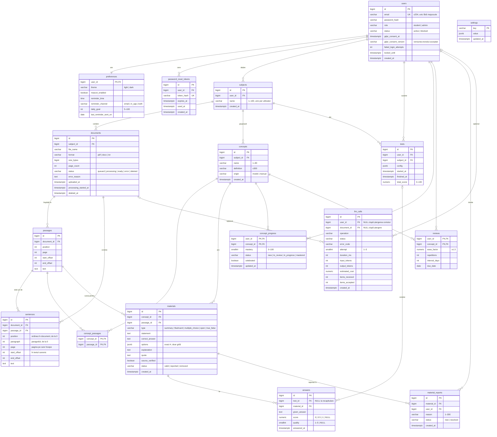

# Modelul de date

Sursa de adevăr este codul: `backend/src/db/schema/*.ts` (Drizzle) și migrarea
`backend/drizzle/0000_init.sql`. Documentul explică de ce arată schema așa.

- Baza: SRS, Tabelul 3.21 (15 entități) + TOKEN_RESETARE din Dosar (C-24) + PROPOZIȚIE (ADR-0013, Q46) = **17 tabele**.
- Valorile închise (roluri, stări, tipuri) sunt definite o singură dată, în
  `backend/src/core/domain.ts`, și folosite atât de constrângerile `CHECK`, cât și de schemele API.
- Convenții: nume `snake_case` în engleză, chei `BIGINT GENERATED ALWAYS AS IDENTITY`, enumerări
  `VARCHAR` + `CHECK`, timp în `timestamptz` (UTC), date calendaristice în `date` (ADR-0004).

## 1. Diagrama

## 2. Corespondența română – engleză

### Entități

| Document (RO)     | Tabel                   | Modul care îl scrie |
| ----------------- | ----------------------- | ------------------- |
| UTILIZATOR        | `users`                 | auth                |
| PREFERINȚE        | `preferences`           | auth                |
| TOKEN_RESETARE    | `password_reset_tokens` | auth                |
| MATERIE           | `subjects`              | documents           |
| DOCUMENT          | `documents`             | documents           |
| PASAJ             | `passages`              | documents           |
| PROPOZIȚIE        | `sentences`             | documents (nu este în SRS; ADR-0013) |
| CONCEPT           | `concepts`              | analysis            |
| CONCEPT_PASAJ     | `concept_passages`      | analysis            |
| MATERIAL          | `materials`             | content             |
| TEST              | `tests`                 | content             |
| RĂSPUNS           | `answers`               | content             |
| PROGRES_CONCEPT   | `concept_progress`      | mastery             |
| RECAPITULARE      | `reviews`               | mastery             |
| RAPORT_MATERIAL   | `material_reports`      | content             |
| APEL_LLM          | `llm_calls`             | llm                 |
| CONFIGURARE       | `settings`              | admin               |

### Câmpuri

| Entitate         | Câmp în SRS / Dosar            | Coloană                              |
| ---------------- | ------------------------------ | ------------------------------------ |
| UTILIZATOR       | e-mail                         | `email`                              |
|                  | hash parolă                    | `password_hash`                      |
|                  | rol (Student, Administrator)   | `role` (`student`, `admin`)          |
|                  | stare (activ, blocat)          | `status` (`active`, `blocked`)       |
|                  | data creării                   | `created_at`                         |
|                  | acord GDPR (dată)              | `gdpr_consent_at`                    |
|                  | — (nu este în SRS; Q42)        | `gdpr_consent_version`               |
|                  | încercări eșuate               | `failed_login_attempts`              |
|                  | blocat până la                 | `locked_until`                       |
| PREFERINȚE       | temă                           | `theme` (`light`, `dark`)            |
|                  | mascotă activă                 | `mascot_enabled`                     |
|                  | ora memento                    | `reminder_time`                      |
|                  | canal memento                  | `reminder_channel` (`email`, `in_app`, `both`) |
|                  | obiectiv zilnic                | `daily_goal`                         |
| TOKEN_RESETARE   | hash_token                     | `token_hash`                         |
|                  | expiră_la                      | `expires_at`                         |
|                  | folosit                        | `used_at` (NULL = nefolosit)         |
| MATERIE          | nume                           | `name`                               |
| DOCUMENT         | nume fișier                    | `file_name`                          |
|                  | format                         | `format` (`pdf`, `docx`, `txt`)      |
|                  | dimensiune (octeți)            | `size_bytes`                         |
|                  | nr. pagini                     | `page_count`                         |
|                  | stare: în coadă                | `status` = `queued`                  |
|                  | stare: în analiză              | `status` = `processing`              |
|                  | stare: gata                    | `status` = `ready`                   |
|                  | stare: eroare                  | `status` = `error`                   |
|                  | stare: șters (Dosar)           | `status` = `deleted`                 |
|                  | motiv eroare                   | `error_reason`                       |
|                  | data încărcării                | `uploaded_at`                        |
| PASAJ            | ordine                         | `position`                           |
|                  | pagină                         | `page`                               |
|                  | poziție început, sfârșit       | `start_offset`, `end_offset`         |
|                  | text                           | `text`                               |
| CONCEPT          | denumire                       | `name`                               |
|                  | definiție                      | `definition`                         |
|                  | origine (model / manual)       | `origin` (`model`, `manual`)         |
| MATERIAL         | pasaj sursă                    | `passage_id`                         |
|                  | tip: rezumat                   | `type` = `summary`                   |
|                  | tip: flashcard                 | `type` = `flashcard`                 |
|                  | tip: grilă                     | `type` = `multiple_choice`           |
|                  | tip: deschisă / răspuns scurt  | `type` = `open`                      |
|                  | tip: adevărat/fals             | `type` = `true_false`                |
|                  | enunț                          | `statement`                          |
|                  | răspuns corect                 | `correct_answer`                     |
|                  | variante (JSON)                | `options`                            |
|                  | explicație                     | `explanation`                        |
|                  | citat                          | `quote`                              |
|                  | sursă verificată               | `source_verified`                    |
|                  | stare (valid, raportat, eliminat) | `status` (`valid`, `reported`, `removed`) |
| TEST             | configurare (JSON)             | `config`                             |
|                  | data începerii / finalizării   | `started_at`, `finished_at`          |
|                  | scor total                     | `total_score`                        |
| RĂSPUNS          | răspuns dat                    | `given_answer`                       |
|                  | scor c                         | `score`                              |
|                  | calitate q                     | `quality`                            |
|                  | data                           | `answered_at`                        |
| PROGRES_CONCEPT  | stăpânire S                    | `mastery`                            |
|                  | status: Nou                    | `status` = `new`                     |
|                  | status: De recapitulat         | `status` = `to_review`               |
|                  | status: În curs                | `status` = `in_progress`             |
|                  | status: Stăpânit               | `status` = `mastered`                |
|                  | ultima actualizare             | `updated_at`                         |
| RECAPITULARE     | EF                             | `ease_factor`                        |
|                  | n                              | `repetitions`                        |
|                  | interval (zile)                | `interval_days`                      |
|                  | data scadentă                  | `due_date`                           |
| RAPORT_MATERIAL  | motiv                          | `reason`                             |
|                  | stare (nou, rezolvat)          | `status` (`new`, `resolved`)         |
| APEL_LLM         | tip operație                   | `operation` (`extract_concepts`, `generate_materials`, `evaluate_answer`) |
|                  | durata (ms)                    | `duration_ms`                        |
|                  | stare                          | `status` (`success`, `error`, `timeout`, `invalid_response`) |
|                  | jetoane intrare, ieșire        | `input_tokens`, `output_tokens`      |
|                  | cost estimat                   | `estimated_cost`                     |
| CONFIGURARE      | cheie, valoare                 | `key`, `value`                       |

Cheile din `settings`: `max_file_size_mb`, `uploads_per_day`, `mastery_threshold_low`,
`mastery_threshold_high`, `mastery_window`, `mastery_decay`, `monthly_cost_limit`.

## 3. Corespondența SRS ↔ Dosar

Dosarul (Figura 5.3) este un model conceptual mai simplu, tot cu 15 entități. Schema păstrează
granularitatea din SRS.

| Dosar (ERD)                              | SRS (Tabelul 3.21)                 | În schemă                                                                 |
| ---------------------------------------- | ---------------------------------- | ------------------------------------------------------------------------- |
| STĂPÂNIRE (S, EF, n, I, următoarea dată) | PROGRES_CONCEPT + RECAPITULARE     | Două tabele, `concept_progress` și `reviews`, cu aceeași cheie compusă (`user_id`, `concept_id`). |
| TOKEN_RESETARE                           | lipsește                           | `password_reset_tokens` (C-24).                                           |
| CONCEPT.document_id                      | CONCEPT.materie                    | `concepts.subject_id`; documentul se deduce prin `concept_passages` → `passages.document_id`. Vezi OPEN_QUESTIONS Q4. |
| APEL_LLM.utilizator_id                   | APEL_LLM.document (poate lipsi)    | Ambele: `user_id` și `document_id`, opționale.                            |
| TEST.creat_la, scor                      | data începerii, data finalizării, scor total | `started_at`, `finished_at`, `total_score`.                     |
| MATERIAL.conținut, stare_verificare      | enunț, răspuns, variante, explicație, citat, sursă verificată, stare | Câmpurile detaliate din SRS.              |
| DOCUMENT.tip, pagini                     | format, nr. pagini                 | `format`, `page_count`.                                                   |

## 4. Coloane care nu apar în SRS

Fiecare adaugă ceva ce o cerință impune, dar entitatea din SRS nu poate reține. Toate sunt
consemnate și în OPEN_QUESTIONS.md.

| Coloană                              | De ce există                                                                                         |
| ------------------------------------ | ---------------------------------------------------------------------------------------------------- |
| `tests.subject_id`                   | RF3: ștergerea materiei trebuie să șteargă testele; fără legătură directă, cascada nu le poate găsi. |
| `users.gdpr_consent_version`         | Q42: se știe ce text de acord a acceptat fiecare utilizator; conturile dinaintea migrării au `1`.    |
| `preferences.last_reminder_sent_on`  | RF19: „cel mult un memento pe zi” trebuie să reziste la repornirea procesului.                       |
| `concept_progress.celebrated`        | RF17: confetti „o singură dată până când conceptul coboară sub prag”.                               |
| `documents.deleted_at`               | Starea „Șters” din Dosar: ștergere logică, cu momentul ei.                                           |
| `documents.processing_started_at`    | Evenimentul PE include „depășire de 60 s”; workerul trebuie să știe când a pornit procesarea.        |
| `llm_calls.user_id`                  | Dosar, C-20.                                                                                         |
| `llm_calls.error_code`, `attempt`    | C-06: codul erorii și numărul reîncercării.                                                          |
| `llm_calls.items_received`, `items_accepted` | RF23 cere rata surselor neverificate, dar C-15 interzice salvarea materialelor respinse; rata se calculează din aceste contoare. |
| `sentences` (tot tabelul)            | Q46, ADR-0013: textul extras se păstrează structurat (propoziții, paragrafe, pagini, poziții); SRS are doar PASAJ. |
| `passages`: `position`               | „ordine” din SRS; `order` este cuvânt rezervat în SQL.                                               |
| `concepts.created_at`, `materials.created_at`, `password_reset_tokens.created_at` | Ordonare stabilă în liste; verificarea „expiră după creare”. |

## 5. Constrângerile netriviale

### Conturi

- **`users_email_lower_key`** — index unic pe `lower(email)`. RF1 cere e-mail unic; fără
  `lower`, `Ana@x.md` și `ana@x.md` ar fi două conturi pentru aceeași căsuță.
- **`users_status_check`** — doar `active` și `blocked`. Blocarea temporară de 15 minute (C-17)
  nu este o a treia valoare: se deduce din `locked_until > now()`. Astfel revenirea la „Activ”
  este automată, fără proces care să rescrie starea, și rezistă la repornirea serverului.
- **`preferences.user_id` cheie primară** — exact o înregistrare per utilizator (C-23).
- **`password_reset_tokens_token_hash_key`** — se păstrează doar hash-ul jetonului (C-24);
  unicitatea permite căutarea directă după hash.

### Materii, documente, pasaje

- **`subjects_user_id_name_key`** — numele materiei este unic per student, nu global (RF3), și fără a ține seama de majuscule: indexul este pe `(user_id, lower(name))` (Q17).
- **`documents_format_check`** — numai `pdf`, `docx`, `txt`. PPTX, acceptat de prototip, nu
  este în SRS.
- **`documents_error_reason_check`** — `(status = 'error') = (error_reason IS NOT NULL)`.
  Un motiv de eroare există exact în starea „Eroare”; la reprocesare trebuie golit.
- **`documents_deleted_at_check`** — `(status = 'deleted') = (deleted_at IS NOT NULL)`.
- **`documents_processing_started_at_check`** — un document „În analiză” are obligatoriu
  momentul pornirii, altfel depășirea de 60 s nu poate fi detectată.
- **Triggerul `documents_enforce_status_transition`** — impune tabelul de stări din Dosar
  (Tabelul 3.1) în baza de date:

  | Din \ În     | queued | processing | ready | error | deleted |
  | ------------ | :----: | :--------: | :---: | :---: | :-----: |
  | (nou)        |   ✔    |            |       |       |         |
  | `queued`     |   RD   |   ✔ PP     |       |       |  ✔ ȘT   |
  | `processing` |        |    RD      | ✔ PR  | ✔ PE  |  ✔ ȘT   |
  | `ready`      |  ✔ RP  |            |  RD   |       |  ✔ ȘT   |
  | `error`      |  ✔ RP  |            |       |  RD   |  ✔ ȘT   |
  | `deleted`    |        |            |       |       |         |

  Un rând șters nu mai poate fi modificat deloc. De aceea un rezultat al modelului sosit târziu
  (C-08 după ștergere, C-10 după eroare) nu poate schimba starea, chiar dacă un serviciu
  greșește. Aceeași tabelă există ca date în
  `backend/src/modules/documents/state-machine.ts`; testele verifică toate cele 30 de celule.
- **`documents_queue_idx`** — index parțial pe `uploaded_at` unde `status = 'queued'`:
  preluarea din coadă (ADR-0003) rămâne rapidă oricâte documente procesate există.
- **`passages_document_id_position_key`** — ordinea pasajelor este unică în document.
- **`sentences_document_id_position_key`** — ordinea propozițiilor este unică în document; cascada
  din `documents` și din `passages` le șterge împreună cu ele (ADR-0013). Pozițiile sunt indici în
  textul canonic, care nu se stochează: se reconstituie din propoziții.

### Concepte și materiale

- **`concept_passages` cheie compusă** — relație N:M; un pasaj nu poate fi legat de două ori de
  același concept.
- **`materials_valid_requires_verified_source_check`** — `status <> 'valid' OR source_verified`.
  Este regula RB1 la nivel de bază de date: un material valid are sursă verificată. `concept_id`
  și `passage_id` sunt `NOT NULL` (SRS 3.4: „un MATERIAL valid are obligatoriu un concept și un
  pasaj sursă verificat”).
- **`materials_options_check`** — o întrebare grilă are exact 4 variante (RF12); celelalte
  tipuri nu au variante.
- **`materials_correct_answer_check`** — doar rezumatul poate să nu aibă răspuns corect.
- **`material_reports_material_id_user_id_key`** — un student raportează un material o singură
  dată (C-19).

### Teste și răspunsuri

- **`answers.test_id` opțional** — NULL pentru răspunsurile din sesiunile de recapitulare (SRS).
- **`answers_test_id_material_id_key`** (index unic parțial, `test_id IS NOT NULL`) — o
  întrebare primește un singur răspuns într-un test; la recapitulare se poate răspunde de
  oricâte ori.
- **`answers_score_check`** — `0`, `0.5`, `1` sau NULL. NULL înseamnă „neevaluat” (C-04):
  modelul nu a fost disponibil și răspunsul poate fi reevaluat.
- **`tests_score_requires_finish_check`** — scorul există doar la un test finalizat (C-05: nu
  se afișează scoruri parțiale).

### Stăpânire și recapitulare

- **Cheie compusă (`user_id`, `concept_id`)** pe `concept_progress` și `reviews` — o singură
  stare pentru fiecare pereche student–concept (Dosar, Tabelul 5.3).
- **`concept_progress_mastery_check`** — S între 0 și 100 (SRS 3.4).
- **`reviews_ease_factor_check`** — EF ≥ 1,3 (SRS 3.4, RB3); valoarea inițială 2,5.

### Jurnal și configurare

- **`llm_calls_error_code_check`** — codul de eroare există exact când apelul nu a reușit.
- **`llm_calls_attempt_check`** — 1–3: prima încercare și cel mult două reîncercări (SRS 3.1.3).
- **`llm_calls_items_check`** — `items_accepted ≤ items_received`.
- `llm_calls` nu are nicio coloană de text: SRS cere păstrarea jurnalului „fără textul
  documentelor”.

## 6. Reguli de ștergere

| Acțiune                         | Efect în baza de date                                                                                                   |
| ------------------------------- | ----------------------------------------------------------------------------------------------------------------------- |
| Ștergerea contului (RF20, RF21) | `DELETE FROM users` → cascadă fizică pe tot ce aparține utilizatorului. `llm_calls` rămâne, cu `user_id` și `document_id` NULL (C-20). |
| Ștergerea materiei (RF3)        | `DELETE FROM subjects` → cascadă fizică: documente, pasaje, concepte, materiale, teste, răspunsuri, progres, recapitulare, rapoarte. |
| Ștergerea documentului (ȘT)     | **Logică**: `status = 'deleted'`, `deleted_at = now()`. Rândul rămâne pentru contorul zilnic (C-07) și pentru a respinge rezultatele tardive (C-08). Serviciul din Segmentul 2 șterge fizic, în aceeași tranzacție, pasajele documentului (de unde, în cascadă, legăturile cu conceptele și materialele) și apoi fișierul de pe disc. |
| Ștergerea conceptului (RF8)     | Cascadă fizică: legături cu pasaje, materiale, progres, recapitulare.                                                   |
| Ștergerea pasajelor             | Cascadă fizică: `concept_passages` și `materials` care le citează (un material fără pasaj sursă ar încălca RB1).         |

Toate cheile străine sunt `ON DELETE CASCADE`, cu excepția celor două din `llm_calls`, care sunt
`ON DELETE SET NULL`.

Ce **nu** poate impune schema și rămâne în sarcina serviciilor (cu teste în segmentul respectiv):

- un student vede doar datele proprii (RNF7): fiecare interogare filtrează după utilizator;
- pasajele unui concept provin dintr-un singur document al aceleiași materii (C-22, Q4);
- cel mult 100 de concepte pe document (RF7);
- un material nu este duplicat pentru același concept și tip (C-13, Q9).

## 7. Migrări

- `npm run db:generate` (drizzle-kit) compară schema cu `backend/drizzle/meta` și scrie
  `backend/drizzle/NNNN_nume.sql`.
- Pentru fiecare migrare se scrie de mână inversa ei, `backend/drizzle/down/NNNN_nume.sql`.
  Un test verifică existența fișierului și faptul că `up → down → up` lasă baza identică.
- `make migrate`, `make migrate-down`, `make migrate-status` (ADR-0002).
- Obiectele pe care drizzle-kit nu le cunoaște (triggerul de stări) se adaugă de mână la
  sfârșitul fișierului generat, sub un comentariu care spune acest lucru.
