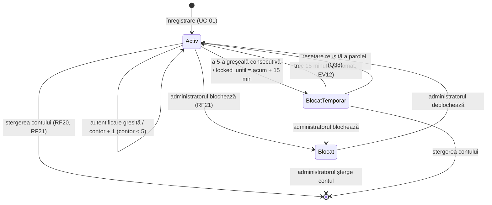

# Proiectarea modulului de conturi și acces (Segmentul 1)

Documentul este specificația pe care o implementează Segmentul 1B. Împreună cu testele din
`backend/tests/auth/` formează contractul: unde textul și un test spun lucruri diferite, testul
are dreptate, iar diferența se semnalează.

- Cerințe acoperite: RF1, RF2, RF18, RF20, RF21 (partea de cont), RNF6, RNF7, RNF8;
  C-11, C-12, C-17, C-23, C-24; UC-01, UC-02, UC-03, UC-11, UC-12; mesajele M01, M02, M03, M10.
- Decizii: ADR-0005 (sesiune în cookie), ADR-0010 (bcrypt), ADR-0011 (amprenta sesiunii, CSRF).
- Întrebări: Q2, Q5, Q11, Q21, Q22, Q33–Q43 din `docs/OPEN_QUESTIONS.md`.

Legendă pentru valori: **[SRS]** = luată din SRS sau Dosar; **[propus]** = propusă aici,
configurabilă, consemnată în OPEN_QUESTIONS.

## 0. Valori

| Valoare                                  | Mărime                        | Sursă                | Configurare                         |
| ---------------------------------------- | ----------------------------- | -------------------- | ----------------------------------- |
| Lungimea e-mailului                      | cel mult 254 de caractere     | [SRS] RF1            | fixă                                |
| Lungimea parolei                         | 8–64 de caractere             | [SRS] RF1            | fixă                                |
| Conținutul parolei                       | cel puțin o literă și o cifră | [SRS] RF1            | fixă                                |
| Lungimea parolei în octeți               | cel mult 72 (UTF-8)           | [propus] Q34         | fixă (limita bcrypt)                |
| Algoritmul de hash                       | bcrypt                        | [SRS] RNF6           | fix                                 |
| Costul bcrypt                            | 12                            | [propus] ADR-0010    | `BCRYPT_COST` (4–15; ≥ 10 în producție) |
| Durata sesiunii                          | 24 de ore                     | [SRS] RF2, RNF6      | `SESSION_TTL_HOURS` (1–24)          |
| Încercări eșuate până la blocare         | 5 consecutive, per e-mail     | [SRS] RF2            | `AUTH_MAX_FAILED_ATTEMPTS`          |
| Durata blocării                          | 15 minute                     | [SRS] RF2, C-17      | `AUTH_LOCK_MINUTES`                 |
| Valabilitatea linkului de resetare       | 1 oră, o singură folosire     | [SRS] RF2, C-24      | `PASSWORD_RESET_TTL_MINUTES`        |
| Cereri pe rutele publice de cont         | 20 pe minut per IP            | [propus, confirmat] Q33 | `RATE_LIMIT_AUTH_MAX`, `RATE_LIMIT_AUTH_WINDOW_SECONDS` |
| Cereri de resetare                       | 3 pe oră per cont             | [propus, confirmat] Q33 | `PASSWORD_RESET_MAX_PER_HOUR`       |
| Jeton de resetare                        | 32 de octeți aleatori         | [propus]             | fix                                 |
| Preferințe implicite                     | temă deschisă, mascotă activă, 18:00, „în aplicație”, 20 | [propus] Q5 | valorile `DEFAULT` din tabel |
| Obiectiv zilnic                          | 5–100                         | [SRS] RF18           | fix                                 |

## 1. Parola și e-mailul

### 1.1 Normalizarea e-mailului (RF1)

1. Se elimină spațiile de la capete.
2. Se trece la litere mici.
3. Se validează formatul și lungimea (cel mult 254 de caractere, după pașii 1–2).

Nu se face nimic altceva: punctele și sufixele `+eticheta` rămân, pentru că regulile diferă de la
un furnizor la altul. Forma normalizată este cea stocată și cea căutată. Aceeași normalizare se
aplică la înregistrare, autentificare și cererea de resetare; este în schema `Email` din
`modules/auth/schemas.ts`, deci nu poate fi uitată pe o rută. Unicitatea este garantată și de
indexul `users_email_lower_key`.

### 1.2 Politica de parolă (RF1, Q34)

O parolă este acceptată dacă îndeplinește toate condițiile:

| Regulă                                   | La încălcare                          |
| ---------------------------------------- | ------------------------------------- |
| 8–64 de caractere                        | M01 (`INVALID_REGISTRATION_DATA`)     |
| cel puțin o literă (orice alfabet)       | M01                                   |
| cel puțin o cifră                        | M01                                   |
| cel mult 72 de octeți în UTF-8           | `PASSWORD_TOO_LONG`, cu limita în mesaj |
| egală cu `password_confirmation`         | M01                                   |

Parola nu se modifică înainte de hash: fără eliminarea spațiilor, fără schimbarea literelor.
Nu există listă de parole interzise și nici reguli de compoziție în plus față de SRS.

Regula de 72 de octeți există fiindcă bcrypt ignoră restul: fără ea, două parole lungi cu același
început ar fi echivalente. Mesajul către utilizator: „Parola este prea lungă: poate avea cel mult
72 de octeți (literele cu diacritice ocupă câte 2).”

**Constrângere tehnică asumată față de SRS.** RF1 acceptă orice parolă de 8–64 de caractere cu o
literă și o cifră. Fiindcă RNF6 impune bcrypt, aplicația respinge o parte dintre ele: o literă cu
diacritice ocupă 2 octeți, iar un emoji 4, deci o parolă de 64 de caractere poate avea până la
256 de octeți. Sunt respinse, de exemplu, parolele cu peste 36 de litere cu diacritice sau cu
peste 18 emoji; parolele scrise doar cu litere fără diacritice, cifre și semne ASCII nu sunt
afectate, oricare le-ar fi lungimea până la 64. Alternativa (hash SHA-256 înainte de bcrypt) ar
respecta litera RF1, dar ar însemna o schemă proprie peste cea numită în RNF6; am ales să
respingem explicit, cu un mesaj care spune limita.

Formulare propusă pentru RF1 în SRS: „Parola are 8–64 de caractere, conține cel puțin o literă
și o cifră și ocupă cel mult 72 de octeți în codificarea UTF-8 (limita algoritmului bcrypt,
RNF6); o parolă mai lungă în octeți este respinsă cu un mesaj care indică limita.”

### 1.3 Stocarea (RNF6, ADR-0010)

- `password_hash = bcrypt(parola, cost = config.auth.bcryptCost)`. Costul implicit este 12.
- Hash-ul se calculează în afara buclei de evenimente (biblioteca nativă `bcrypt` folosește firele
  de execuție ale Node), ca 50 de utilizatori simultani să nu se blocheze reciproc.
- La autentificarea reușită, dacă hash-ul stocat are alt cost decât cel configurat, se
  recalculează cu costul curent și se salvează. Atenție: asta schimbă amprenta sesiunii (2.2),
  deci rehash-ul se face **înainte** de emiterea cookie-ului.
- Parola nu se stochează, nu se jurnalizează și nu se întoarce în niciun răspuns. `password_hash`
  nu părăsește niciodată repository-ul decât către serviciul `auth`.

### 1.4 Timp de răspuns egal

Când e-mailul nu are cont, autentificarea compară totuși parola cu un hash fictiv, calculat o
dată la pornire cu același cost. Fără asta, un răspuns rapid ar arăta că adresa nu există.

## 2. Sesiunea

### 2.1 Cookie (RF2, RNF6, ADR-0005)

```
Set-Cookie: recap_session=<JWT>; Path=/; HttpOnly; SameSite=Lax; Max-Age=86400
            [; Secure]        ← numai când NODE_ENV=production
```

- Numele vine din `SESSION_COOKIE_NAME`; `Max-Age` = `SESSION_TTL_HOURS` × 3600.
- Ștergerea: același nume și aceleași atribute, valoare goală, `Max-Age=0`.
- Fără atributul `Domain` (cookie doar pentru gazda care l-a emis).

### 2.2 Jetonul (RFC 7519, ADR-0011)

Antet: `{"alg":"HS256","typ":"JWT"}`. Semnătură: HMAC-SHA256 cu `SESSION_SECRET`.

| Câmp  | Conținut                                                                         |
| ----- | -------------------------------------------------------------------------------- |
| `sub` | identificatorul utilizatorului, ca șir                                           |
| `iat` | momentul emiterii, în secunde                                                    |
| `exp` | `iat` + durata sesiunii                                                          |
| `pfp` | amprenta parolei (vezi mai jos)                                                  |

Jetonul nu conține e-mailul, rolul sau altceva: rolul se citește din bază la fiecare cerere.

**Amprenta parolei.**

```
pfp = base64url( primii 16 octeți din HMAC-SHA256( cheie = SESSION_SECRET,
                                                   mesaj = "recap:pfp:v1:" + password_hash ) )
```

22 de caractere, fără completare. Este un HMAC cu secretul serverului, deci jetonul, care poate fi
citit pe client, nu conține nimic din hash și nu ajută la ghicirea parolei. Când parola se
schimbă, hash-ul se schimbă, amprenta nu mai corespunde și **toate** sesiunile contului devin
invalide, fără tabel de sesiuni și fără coloană nouă.

### 2.3 Verificarea la fiecare cerere

Pentru o rută care nu este publică, în ordine:

1. Cookie-ul există și jetonul are exact trei părți.
2. Antetul spune `alg: HS256`. Orice altă valoare, inclusiv `none`, este respinsă.
3. Semnătura este corectă (comparație în timp constant).
4. `exp` este în viitor, iar `sub` este un întreg pozitiv.
5. Utilizatorul `sub` există în bază. **Se citește la fiecare cerere.**
6. Amprenta recalculată din `password_hash` este egală cu `pfp` (comparație în timp constant).
7. `status = 'active'`.
8. Rolul corespunde nivelului rutei.

| Eșec la pasul | Răspuns                                   | Cookie            |
| ------------- | ----------------------------------------- | ----------------- |
| 1–6           | `401 UNAUTHENTICATED`                     | șters, dacă exista |
| 7             | `403 ACCOUNT_BLOCKED`                     | păstrat           |
| 8             | `403 FORBIDDEN`                           | păstrat           |

`401 UNAUTHENTICATED` este semnalul pentru ecranul D15 „Sesiune expirată” (C-11). Răspunsul este
același pentru toate cauzele de la pașii 1–6: clientul nu află de ce a fost respins.

Sesiunea **nu se prelungește** la activitate (Q41): `expires_at` din răspunsuri este `exp`.

### 2.4 Invalidarea

| Eveniment                         | Efect                                                             |
| --------------------------------- | ----------------------------------------------------------------- |
| Deconectare                       | Cookie-ul este șters. Jetonul nu este revocat.                    |
| Resetarea parolei                 | Toate sesiunile contului devin invalide (amprenta).               |
| Blocare de către administrator    | Următoarea cerere primește `403 ACCOUNT_BLOCKED`.                 |
| Ștergerea contului                | Următoarea cerere primește `401` (utilizatorul nu mai există).    |
| Expirare (24 h)                   | `401`.                                                            |
| Schimbarea `SESSION_SECRET`       | Toate sesiunile tuturor conturilor devin invalide.                |

**Risc acceptat.** După deconectare, un jeton copiat înainte rămâne valid până la expirare (cel
mult 24 de ore) sau până la schimbarea parolei. Cookie-ul este `HttpOnly`, deci un script din
pagină nu îl poate citi; furtul cere acces la dispozitiv sau la trafic necriptat. Opțiune
viitoare, dacă riscul nu mai este acceptabil: coloana `users.session_version`, inclusă în jeton
și incrementată la deconectare (deconectează toate dispozitivele).

### 2.5 CSRF (SRS 3.5.1, ADR-0011)

Trei straturi, toate obligatorii:

1. **`SameSite=Lax`**: browserul nu trimite cookie-ul la cererile `POST/PATCH/DELETE` pornite de
   pe alt site.
2. **Verificarea originii**, pe toate rutele `/api/v1` cu metodă care modifică date
   (`POST`, `PATCH`, `PUT`, `DELETE`), inclusiv cele publice:
   - dacă antetul `Origin` există și nu este egal cu originea din `APP_BASE_URL` →
     `403 ORIGIN_NOT_ALLOWED`;
   - dacă `Origin` lipsește și `Sec-Fetch-Site` este `cross-site` → `403 ORIGIN_NOT_ALLOWED`;
   - altfel cererea trece. Un client fără browser (curl, teste) nu trimite aceste antete și nu
     are cookie-uri ambientale, deci nu este o țintă CSRF.
3. **Nicio rută `GET` nu modifică date.** Regula ține de contract; o verifică recenzia.

Încărcarea fișierelor este `multipart/form-data`, pe care un formular de pe alt site îl poate
trimite fără cerere preliminară; de aceea verificarea originii nu se poate baza doar pe
`Content-Type` și se aplică tuturor metodelor care modifică date.

## 3. Blocarea, limitarea ratei, anti-enumerarea

### 3.1 Stările contului (RF2, C-17, Q2)

SRS și Dosarul nu au o diagramă de stări a contului (C-17 constată lipsa). Aceasta este ea:



| Stare            | În baza de date                                         |
| ---------------- | ------------------------------------------------------- |
| Activ            | `status = 'active'` și (`locked_until` NULL sau trecut) |
| Blocat temporar  | `status = 'active'` și `locked_until > now()`           |
| Blocat           | `status = 'blocked'`                                    |

„Blocat temporar” nu este o valoare a coloanei `status`. Revenirea la „Activ” nu cere niciun
proces: este o comparație cu ceasul, deci rezistă la repornirea serverului (C-17).

### 3.2 Algoritmul de autentificare

Intrare: `email` (normalizat), `password`. Fie `MAX = 5`, `LOCK = 15 min`.

1. Se caută utilizatorul după e-mail.
2. **Nu există** → se compară parola cu hash-ul fictiv (1.4) → `401 INVALID_CREDENTIALS`.
3. **`locked_until > acum`** → `429 ACCOUNT_TEMPORARILY_LOCKED`, cu
   `details.retry_after_seconds` și antetul `Retry-After`. Parola nu se verifică, contorul nu se
   modifică. Răspunsul este același și pentru parola corectă.
4. **`locked_until` există, dar a trecut** → contorul se consideră 0 (și se scrie 0 împreună cu
   `locked_until = NULL` la pasul 5 sau 6).
5. **Parola greșită** → contorul crește cu 1, atomic (`UPDATE … SET failed_login_attempts =
   failed_login_attempts + 1 … RETURNING`).
   - Dacă noul contor `< MAX` → `401 INVALID_CREDENTIALS`.
   - Dacă noul contor `= MAX` → `locked_until = acum + LOCK` și răspunsul este deja
     `429 ACCOUNT_TEMPORARILY_LOCKED` cu `retry_after_seconds = 900`. A 5-a greșeală este cea
     care afișează timpul rămas (C-12).
6. **Parola corectă**:
   - `status = 'blocked'` → `403 ACCOUNT_BLOCKED`. Contorul nu se modifică.
   - altfel → contor 0, `locked_until = NULL`, eventual rehash (1.3), cookie, `200` cu
     `SessionResponse`.

`retry_after_seconds` = secundele rămase până la `locked_until`, rotunjite în sus, între 1 și
`LOCK × 60`. Interfața îl afișează și dezactivează butonul (C-12).

Mesajul M03 este identic pentru „e-mail inexistent” și „parolă greșită”. Un cont blocat de
administrator răspunde M03 la parolă greșită: blocarea se află numai cu parola corectă (Q36).

### 3.3 Limitarea ratei (Q33)

- **Per IP**, pe rutele publice de cont (`register`, `login`, `password-reset/request`,
  `password-reset/confirm`, `reminders/unsubscribe`): cel mult `RATE_LIMIT_AUTH_MAX` cereri în
  `RATE_LIMIT_AUTH_WINDOW_SECONDS`, numărate împreună. La depășire: `429 TOO_MANY_REQUESTS`, cu
  `details.retry_after_seconds` și `Retry-After`. Cererea respinsă nu ajunge la validare și nu
  atinge baza de date.
- **Per cont**, pentru cererile de resetare: cel mult `PASSWORD_RESET_MAX_PER_HOUR` jetoane
  create într-o oră (numărate din `password_reset_tokens.created_at`). Peste limită, răspunsul
  rămâne `202`, dar nu se creează jeton și nu se trimite e-mail.
- Contorul per IP este în memoria procesului și ține de instanța aplicației (nu este global în
  modul), ca testele să poată porni aplicații cu limite diferite. Adresa IP este cea a
  conexiunii; antetul `X-Forwarded-For` se folosește numai cu `TRUST_PROXY=true`.
- **La demonstrație**, mai mulți utilizatori din aceeași rețea (sală, Wi-Fi-ul facultății) ies
  pe internet cu aceeași adresă IP publică și împart cele 20 de cereri pe minut. Limita se
  mărește din configurare (`RATE_LIMIT_AUTH_MAX`, de exemplu 200), fără modificări de cod;
  blocarea per cont (3.2) rămâne neschimbată.

### 3.4 Anti-enumerarea

| Rută                         | Comportament                                                                 |
| ---------------------------- | ---------------------------------------------------------------------------- |
| `login`                      | Același răspuns și, pe cât posibil, același timp pentru e-mail inexistent și parolă greșită. |
| `password-reset/request`     | Întotdeauna `202`, fără corp, indiferent dacă adresa are cont, dacă e blocat sau dacă limita e atinsă. |
| `password-reset/confirm`     | Același `RESET_TOKEN_INVALID` pentru jeton necunoscut, expirat sau folosit.   |
| Resursele altui utilizator   | `404 NOT_FOUND`, la fel ca pentru o resursă inexistentă; niciodată `403`.     |

**Excepții cerute de SRS** (Q35), acceptate și documentate:

1. `register` răspunde M02 („Există deja un cont cu această adresă”) — RF1.
2. După a 5-a încercare greșită, un cont existent răspunde `429`, iar o adresă fără cont rămâne
   la `401` — RF2, M03, C-12. Atenuare: limita per IP.

## 4. Resetarea parolei (RF2, C-24, UC-03)

### 4.1 Cererea — `POST /auth/password-reset/request`

1. Răspunsul este întotdeauna `202`, fără corp.
2. Dacă e-mailul are cont cu `status = 'active'` și limita per cont nu este atinsă:
   - se generează 32 de octeți aleatori (`crypto.randomBytes`), codificați base64url: jetonul,
     43 de caractere;
   - se inserează în `password_reset_tokens`: `token_hash` = SHA-256 al jetonului, în
     hexazecimal (64 de caractere); `expires_at` = acum + 1 oră;
   - se apelează `sendPasswordResetEmail` cu `to`, `resetUrl`, `expiresAt`.
3. `resetUrl = APP_BASE_URL + "/reset-password?token=" + jeton`.
4. Un cont blocat temporar poate cere resetarea. Un cont blocat de administrator nu primește
   nimic (Q36).
5. Jetonul în clar există doar în memorie, pe durata cererii, și în e-mail. Nu se stochează și
   nu se jurnalizează. SHA-256 este suficient fiindcă jetonul are 256 de biți aleatori; bcrypt ar
   fi inutil și lent.
6. Eșecul trimiterii nu schimbă răspunsul (`202`); se jurnalizează fără jeton.

Trimiterea e-mailului aparține Segmentului 8. Până atunci, `sendPasswordResetEmail` din
`modules/reminders/service.ts` scrie legătura în jurnal **numai când mediul nu este producție**;
în producție nu face nimic și avertizează. Testele injectează un expeditor fals prin
`buildApp({ sendPasswordResetEmail })`.

### 4.2 Confirmarea — `POST /auth/password-reset/confirm`

1. Corpul se validează (politica de parolă, confirmarea egală). Date invalide →
   `400 VALIDATION_ERROR` sau `PASSWORD_TOO_LONG`; jetonul **nu** este consumat.
2. Se caută `token_hash` = SHA-256(jeton). Negăsit, `used_at` completat sau `expires_at` trecut →
   `400 RESET_TOKEN_INVALID`.
3. Într-o singură tranzacție:
   - `users.password_hash` = hash-ul noii parole;
   - `failed_login_attempts = 0`, `locked_until = NULL` (Q38);
   - `used_at = acum` pentru **toate** jetoanele nefolosite ale contului (Q39).
   Marcarea jetonului se face cu `UPDATE … WHERE used_at IS NULL … RETURNING`, ca două confirmări
   simultane cu același jeton să nu reușească amândouă.
4. Răspuns `204`. **Nu** se emite cookie: utilizatorul se autentifică cu noua parolă.
5. Toate sesiunile existente devin invalide prin amprentă (2.4).

### 4.3 Curățarea

`purgeResetTokens()` șterge rândurile cu `expires_at` trecut sau `used_at` completat și întoarce
numărul lor. Rulează în worker o dată pe oră (`authWorkerTasks`). Un jeton șters răspunde la fel
ca unul necunoscut. Tabelul este în modulul `auth`, deci și sarcina este a lui.

## 5. Ștergerea contului (RF20, RF21, UC-12, UC-13)

### 5.1 De către student — `POST /account/delete`

1. Sesiune de student. Corp: `{ "password": "…" }`. Interfața cere confirmarea M10 înainte.
2. Parola se verifică cu bcrypt. Greșită → `403 PASSWORD_CONFIRMATION_FAILED`; nimic nu se șterge.
   Greșelile de aici nu se numără la blocarea autentificării.
3. Într-o tranzacție: `DELETE FROM users WHERE id = …`. Cascada din schemă face restul.
4. După `COMMIT`: `userFiles.deleteAllForUser(userId)` (Q43). Un eșec aici se jurnalizează; contul
   rămâne șters.
5. Răspuns `204`, cu ștergerea cookie-ului. Eveniment de audit `account.deleted`.

### 5.2 Ce se șterge și ce rămâne

| Date                                                                    | Efect                              |
| ----------------------------------------------------------------------- | ---------------------------------- |
| `users`, `preferences`, `password_reset_tokens`                         | șterse                             |
| `subjects` → `documents` (inclusiv cele șterse logic) → `passages`      | șterse în cascadă                  |
| `concepts`, `concept_passages`, `materials`, `material_reports`         | șterse în cascadă                  |
| `tests`, `answers`, `concept_progress`, `reviews`                       | șterse în cascadă                  |
| Rapoartele trimise de utilizator despre materiale                       | șterse                             |
| `llm_calls`                                                             | **rămân**, cu `user_id` și `document_id` NULL (C-20) |
| Fișierele încărcate                                                     | șterse de pe disc după `COMMIT`    |
| Copiile de rezervă                                                      | expiră în cel mult 30 de zile (operațional) |
| Liniile de jurnal                                                       | rămân; conțin doar identificatorul |
| Pasajele deja trimise furnizorului modelului de limbaj                  | **nu pot fi șterse** de aplicație (vezi mai jos) |

Datele deja trimise furnizorului modelului de limbaj (pasaje din documente, răspunsuri deschise)
nu pot fi șterse la ștergerea contului: aplicația nu are control asupra copiilor păstrate de
furnizor. Ce se trimite și în ce condiții le păstrează furnizorul este subiectul ADR-0012;
studentul trebuie informat despre asta în textul acordului de la înregistrare (RF1).

Ordinea contează: întâi baza de date, apoi fișierele. Dacă procesul cade între ele, rămân fișiere
orfane, care nu mai pot fi atinse prin aplicație; invers, ar rămâne înregistrări către fișiere
inexistente.

După ștergere, aceeași adresă de e-mail poate fi înregistrată din nou, ca un cont nou.

### 5.3 De către administrator (RF21)

Serviciul `auth` oferă `deleteUser(actor, userId)` și `setUserStatus(actor, userId, status)`;
rutele sunt ale Segmentului 7. Efectul ștergerii este același ca la 5.1, fără parolă. Reguli (Q37):

- țintă inexistentă → `404 NOT_FOUND`;
- ținta este un cont de administrator (inclusiv propriul cont) → `409 CONFLICT`;
- blocarea unui cont deja blocat sau deblocarea unuia activ → `409 CONFLICT`.

### 5.4 Exportul (RF20, Q11) — `GET /account/export`

- `format=json` (implicit): `200`, `application/json`, forma `AccountExport`,
  `Content-Disposition: attachment; filename="recap-export-AAAA-LL-ZZ.json"`.
- `format=csv`: `200`, `application/zip`, cu fișierele `subjects.csv`, `concepts.csv`,
  `tests.csv`, `answers.csv`, `progress.csv`; `filename="recap-export-AAAA-LL-ZZ.zip"`.
- Conține numai datele utilizatorului curent. Nu conține `password_hash`, jetoane sau textul
  documentelor. Datele celorlalte module se cer prin serviciile lor.

## 6. Roluri și autorizare (RNF7, SRS 3.7.2)

### 6.1 Un singur hook global

`registerAuthHooks(app, service)` adaugă un hook `onRequest` pe domeniul `/api/v1`. Fiecare rută
își declară nivelul prin `endpoint()`, în `config.auth`:

| Nivel     | Cine trece                                 |
| --------- | ------------------------------------------ |
| `public`  | oricine; cookie-ul nu este citit           |
| `any`     | orice utilizator autentificat și activ     |
| `student` | numai rolul `student`                      |
| `admin`   | numai rolul `admin`                        |

Ordinea în hook: (1) verificarea originii, (2) limita per IP pe rutele publice de cont,
(3) autentificarea, (4) rolul. Totul se întâmplă în `onRequest`, **înainte** de validarea
corpului: un vizitator neautentificat primește `401`, nu detalii de validare.

După hook, `request.user` este `{ id, role, email }` pe rutele protejate și `null` pe cele
publice. `request.actor` este obiectul `Actor` (6.3). Routerele nu verifică niciodată roluri.

Un administrator **nu** trece pe rutele `student`: nu are acces la datele de studiu (SRS 3.4).
Un cont de administrator nu poate fi folosit și ca student.

### 6.2 Vizitatorul nu este un rol stocat

„Vizitator” înseamnă absența sesiunii. `users.role` are doar `student` și `admin`. Înregistrarea
creează întotdeauna un `student`; un administrator se creează numai cu `npm run admin:create`
(Q21), niciodată prin API.

### 6.3 „Un utilizator vede doar datele lui”, fără să depindă de disciplină

Trei mecanisme care se sprijină reciproc:

1. **`Actor` ca prim parametru obligatoriu** (`core/actor.ts`). Orice funcție de repository care
   atinge date ale utilizatorilor primește un `Actor` și filtrează după `actor.userId`. Tipul
   este marcat (branded): nu poate fi construit dintr-un literal, ci doar prin
   `actorFromUser(request.user)` sau `systemActor(motiv)` pentru worker. O interogare scrisă fără
   actor nu compilează, iar `systemActor` se poate căuta în cod la recenzie.
2. **`404` pentru resursa altcuiva.** Serviciul caută resursa cu filtrul de proprietar; dacă nu o
   găsește, răspunde `NOT_FOUND`. Nu există ramură „există, dar nu e a ta”.
3. **Testul automat de proprietate** (`tests/helpers/authorization.ts`). Pornește de la OpenAPI:
   ia fiecare operație de student cu parametri în cale, creează resursele ca utilizatorul A și
   face cererea ca utilizatorul B. Așteaptă `404`. Dacă apare o rută nouă cu un parametru pentru
   care nu există un generator de resurse, testul **pică** până când cineva îl adaugă. Un
   endpoint nou nu poate scăpa neverificat.

Rutele încă neimplementate (`501`) sunt sărite automat și intră în verificare în ziua în care
segmentul lor le implementează.

### 6.4 Conturile de administrator (Q21, Q37)

Prin API nu se poate crea, bloca sau șterge un cont de administrator. Gestionarea lor se face de
pe server, de către cine are acces la mașină și la baza de date:

| Operație                 | Cum                                                                                   |
| ------------------------ | ------------------------------------------------------------------------------------- |
| Creare (și contul inițial, SRS 2.1.8) | `npm --prefix backend run admin:create -- --email <adresă>`; parola se cere interactiv, nu ca argument, și respectă politica din 1.2. Se poate rula de mai multe ori, pentru mai mulți administratori. O adresă care are deja cont este refuzată. Eveniment de audit: `admin.created`. |
| Schimbarea parolei       | Resetarea prin e-mail (4), ca pentru orice cont.                                      |
| Blocare sau ștergere     | Direct în baza de date: `UPDATE users SET status = 'blocked' WHERE id = …` sau `DELETE FROM users WHERE id = …`. Efectul este imediat, fiindcă utilizatorul se citește la fiecare cerere (2.3). |
| Retrogradare la student  | Nu există: un cont de administrator nu are date de studiu. Se șterge și se creează un cont nou. |

`make seed` scrie doar setările implicite; nu creează conturi, ca să nu existe o parolă
implicită în cod sau în `.env`. Scriptul `admin:create` este scris de Segmentul 1B (9, punctul 5)
peste `AuthService.createAdmin`, a cărui comportare este deja fixată de
`tests/auth/admin-accounts.test.ts`.

## 7. Jurnalizare

### 7.1 Evenimente de audit (SRS 2.4, 3.6.3)

Toate prin `auditLog()`, cu `audit: true`, `action`, `actor_id`, `target`, `result`.

| `action`                         | Când                                             | `actor_id`  | `target`                    |
| -------------------------------- | ------------------------------------------------ | ----------- | --------------------------- |
| `account.registered`             | înregistrare reușită                             | utilizator  | —                           |
| `auth.login_succeeded`           | autentificare reușită                            | utilizator  | —                           |
| `auth.login_failed`              | e-mail inexistent sau parolă greșită             | `null`      | `{ user_id }` dacă există   |
| `auth.account_locked`            | a 5-a greșeală                                   | `null`      | `{ user_id }`               |
| `auth.logout`                    | deconectare                                      | utilizator  | —                           |
| `auth.password_reset_requested`  | jeton creat                                      | `null`      | `{ user_id }`               |
| `auth.password_reset_completed`  | parolă schimbată                                 | utilizator  | —                           |
| `auth.password_reset_rejected`   | jeton invalid                                    | `null`      | —                           |
| `auth.rate_limited`              | limită per IP depășită                           | `null`      | `{ route }`                 |
| `auth.origin_rejected`           | origine nepermisă                                | `null`      | `{ route }`                 |
| `account.exported`               | export                                           | utilizator  | `{ format }`                |
| `account.deleted`                | ștergere (de student sau de administrator)       | cine a șters | `{ user_id }`              |
| `account.blocked` / `account.unblocked` | acțiunea administratorului                | administrator | `{ user_id }`             |
| `admin.created`                  | `npm run admin:create`                           | `null`      | `{ user_id }`               |

Eșecurile au `result: "failure"`.

### 7.2 Ce nu apare niciodată în jurnal

- parola și confirmarea ei, în nicio formă;
- `password_hash`, `token_hash`;
- jetonul de resetare și legătura de resetare (excepție: stub-ul din 4.1, **în afara producției**);
- valoarea cookie-ului, JWT-ul, antetele `Cookie`, `Set-Cookie`, `Authorization`;
- `SESSION_SECRET`;
- adresa de e-mail: evenimentele identifică utilizatorul prin `user_id`. La o autentificare
  eșuată cu e-mail necunoscut nu se scrie adresa încercată.

`core/logger.ts` ascunde deja antetele și câmpurile `password`, `password_confirmation`, `token`.
Corpul cererilor nu se jurnalizează deloc. Un test (`tests/auth/logging.test.ts`) parcurge toate
fluxurile și caută în jurnal parola, jetonul, cookie-ul și hash-ul.

## 8. Modelul de amenințări

| Atac                                  | Cum este acoperit                                                                                          | Verificat de                    |
| ------------------------------------- | ---------------------------------------------------------------------------------------------------------- | ------------------------------- |
| **Forță brută pe un cont**            | Blocare 15 minute după 5 greșeli consecutive (3.2); bcrypt cost 12 încetinește fiecare încercare.            | `login-lockout.test.ts`         |
| **O parolă încercată pe multe conturi** | Limita per IP (3.3).                                                                                      | `rate-limit.test.ts`            |
| **Spargerea hash-urilor furate**      | bcrypt cu sare per parolă, cost configurabil, rehash la creșterea costului (1.3).                           | `register.test.ts`              |
| **Furt de sesiune prin XSS**          | Cookie `HttpOnly`; jetonul nu ajunge niciodată în JavaScript.                                               | `session.test.ts`               |
| **Furt de sesiune pe rețea**          | `Secure` în producție; HTTPS (RNF6).                                                                        | `session.test.ts`               |
| **Jeton falsificat**                  | Semnătură HS256; `alg` fixat; `none` respins; comparații în timp constant (2.3).                            | `session.test.ts`               |
| **Jeton furat, folosit după schimbarea parolei** | Amprenta parolei (2.2).                                                                         | `password-reset.test.ts`        |
| **Jeton furat, folosit după deconectare** | **Risc acceptat** (2.4), limitat la 24 de ore.                                                          | —                               |
| **Enumerarea conturilor**             | Răspunsuri uniforme (3.4), timp egal (1.4); două excepții cerute de SRS.                                    | `login.test.ts`, `password-reset.test.ts` |
| **CSRF**                              | `SameSite=Lax` + verificarea originii + niciun `GET` care modifică (2.5).                                   | `csrf.test.ts`                  |
| **IDOR**                              | `Actor` obligatoriu, `404` pentru resursa altcuiva, test automat pe toate rutele (6.3).                     | `ownership.test.ts`             |
| **Escaladarea rolului**               | Rolul citit din bază la fiecare cerere, nu din jeton; înregistrarea creează doar studenți (6.2).            | `access-control.test.ts`        |
| **Preluarea contului prin resetare**  | Jeton de 256 de biți, stocat ca hash, o oră, o singură folosire, limită per cont (4).                       | `password-reset.test.ts`        |
| **Scurgeri prin jurnal**              | Lista din 7.2.                                                                                              | `logging.test.ts`               |
| **Ștergerea contului de către altcineva cu sesiunea deschisă** | Confirmare cu parola (5.1).                                                       | `account-delete.test.ts`        |

În afara modelului, pentru versiunea 1: autentificare în doi pași, detectarea dispozitivelor noi,
verificarea adresei de e-mail la înregistrare (SRS nu o cere), parole compromise cunoscute.

## 9. Ce are de făcut Segmentul 1B

1. Dependențe, cu justificare în commit: `bcrypt` (RNF6; nativ, vezi ADR-0010) și, dacă se
   aleg, `@fastify/cookie` și o bibliotecă JWT (`jose`). Formatul cookie-ului și al jetonului
   este fixat aici și verificat de teste, deci biblioteca este un detaliu. Arhiva ZIP a
   exportului (Q11) poate fi scrisă fără dependență: fișiere stocate necomprimat, cu `crc32`
   din `node:zlib`.
2. `modules/auth/repository.ts` și `service.ts`: implementează interfețele din `types.ts`, fără
   să le schimbe forma. `createAuthService` și `registerAuthHooks` au deja semnătura.
3. `app.ts`: construiește serviciul cu `createAuthService`, îl pune pe `app.auth`
   (`app.decorate`), apelează `registerAuthHooks(api, app.auth)` în domeniul `/api/v1`, imediat
   după `requireDeclaredAccess`. Dependențele vin din `AppDependencies`: `sendPasswordResetEmail`
   (implicit `createPasswordResetSender` din modulul `reminders`) și `userFiles` (implicit o
   implementare care nu face nimic și avertizează, până la Segmentul 2).
4. `worker.ts`: adaugă `authWorkerTasks` în `collectTasks()`.
5. `scripts/create-admin.ts` și scriptul `admin:create`.
6. Înlocuiește `notImplemented` în `modules/auth/router.ts`. Pentru M01, ruta de înregistrare
   folosește `attachValidation: true` și transformă eroarea de validare în
   `INVALID_REGISTRATION_DATA`, cu aceleași `details` (`path` de forma `body/<câmp>`).
7. **Elimină excluderea testelor** — obligatoriu: șterge `backend/vitest.auth.config.ts`,
   scriptul `test:auth`, ținta `test-auth` din Makefile, linia `exclude` din
   `backend/vitest.config.ts` și jobul `auth-spec` din `.github/workflows/ci.yml`. La final,
   `make test` rulează și testele din `tests/auth/` și trece.
8. Adaugă `'auth'` în `IMPLEMENTED_TAGS` din `tests/api-contract.test.ts`. Testul de contract
   este deja pregătit pentru hook: își ia singur sesiuni când autentificarea există.
9. Nu modifică testele din `tests/auth/` ca să treacă. Dacă un test pare greșit, se semnalează
   și se așteaptă decizia.
10. Parcurge `docs/design/auth-checklist.md`, secțiunea A.

Pentru segmentele următoare: sesiunile de test se iau din `tests/helpers/session.ts`
(`registerStudent`, `registerAdmin`), iar `describeOwnership` din
`tests/helpers/authorization.ts` verifică automat rutele noi.

## 10. Limitări și dezvoltări viitoare

| Limitare                                                   | De ce                                         | Ce ar cere                                             |
| ---------------------------------------------------------- | --------------------------------------------- | ------------------------------------------------------ |
| Parola nu se poate schimba din cont; doar prin resetarea prin e-mail (Q40) | Nu este în SRS (RF2, RF18–RF20).    | O rută care cere parola curentă; sesiunile se invalidează prin amprentă (ADR-0011). |
| Adresa de e-mail nu se poate schimba (Q40)                 | Nu este în SRS.                               | Confirmarea noii adrese printr-un link, înainte de înlocuire. |
| Un jeton furat rămâne valid după deconectare, cel mult 24 h (Q22) | Sesiune fără stare pe server.          | Coloana `users.session_version` (ADR-0011).            |
| Sesiunea nu se prelungește la activitate (Q41)             | Citirea literală a RF2.                       | Reemiterea jetonului, cu o durată maximă absolută.     |
| Parolele de peste 72 de octeți sunt respinse (Q34, 1.2)    | Limita bcrypt, impus de RNF6.                 | Modificarea SRS (formularea din 1.2) sau alt algoritm. |
| Limita per IP este în memoria unui singur proces (Q33)     | Pilotul rulează un singur proces API.         | Contor în baza de date sau într-un depozit comun.      |
| Conturile de administrator se blochează și se șterg doar din baza de date (Q37, 6.4) | Evită rămânerea fără administrator. | Reguli de tipul „rămâne cel puțin un administrator activ”. |
| Acordul GDPR nu are versiune (Q42)                         | UTILIZATOR păstrează doar data.               | Versiunea textului acceptat, pe utilizator.            |
| Datele trimise furnizorului modelului nu pot fi șterse (5.2) | Sunt în afara sistemului.                   | Vezi ADR-0012.                                         |
